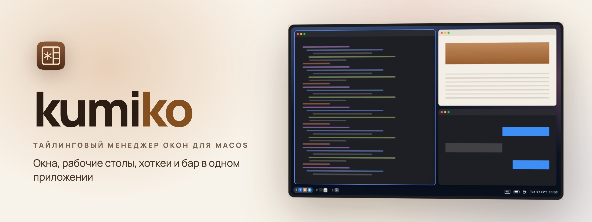
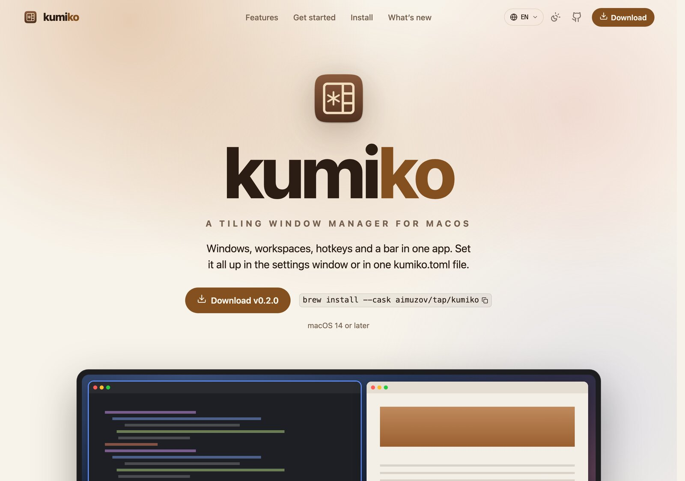

<p align="center">
	<a href="README.md"></a>
	
</p>

<!-- template-only: баннер самого шаблона, site-bootstrapper вырезает этот блок из нового сайта. -->
<p align="center">
	<a href="https://github.com/aimuzov/infra-site-template"></a>
</p>
<!-- /template-only -->

<!-- Раскомментировать, когда в .github/assets появится banner.jpg.
<p align="center">
	<a href="https://__DOMAIN__"></a>
</p>
-->

<p align="center">
	<a href="https://github.com/aimuzov/__PROJECT__/actions/workflows/deploy.yml"></a>
	<a href="https://__DOMAIN__"></a>
	<a href="package.json"></a>
	<a href="https://astro.build"></a>
	<a href="https://svelte.dev"></a>
	<a href="LICENSE"></a>
</p>

<h3 align="center">__DESCRIPTION__</h3>

<!-- Раскомментировать, когда в .github/assets появятся скриншоты.
<table>
	<tr>
		<td width="50%" align="center"><br><b>Главная</b> для посетителей</td>
		<td width="50%" align="center"><br><b>Экран</b> что на нём</td>
	</tr>
</table>
-->

<p>Живёт на <a href="https://__DOMAIN__">__DOMAIN__</a>. Статичный сайт на <a href="https://astro.build">Astro</a>, интерактивные островки на <a href="https://svelte.dev">Svelte</a>.</p>

## Что внутри

- **Главная** (`/`): название и описание сайта из [`src/frontend/data/site.ts`](src/frontend/data/site.ts).
- **404**: заглушка «такой страницы нет» со ссылкой на главную.
- **Футер**: подпись автора из [infra-site-kit](https://github.com/aimuzov/infra-site-kit) со ссылкой на исходный код, `repo` в [`site.ts`](src/frontend/data/site.ts).
- **Аналитика**: Яндекс Метрика, компонент счётчика берётся из [infra-site-kit](https://github.com/aimuzov/infra-site-kit) и сам добавляет свои источники в CSP; номер счётчика — `metrikaId` в [`site.ts`](src/frontend/data/site.ts).

## Как устроено

Всё лежит в `src/`:

- [`src/frontend`](src/frontend): сайт на Astro, это `srcDir` в `astro.config.mjs`. Импорты — через `#frontend/*`.
- [`src/backend`](src/backend): API рядом с сайтом, как в shkatova-psychologist и community-taplist. Голый Node запускает TypeScript, без сборки и зависимостей; импорты через `#backend/*`, общий для обеих сторон код — в `src/shared` (`#shared/*`). В нём уже есть `GET /api/health`: его опрашивает деплой после релиза (`health-url` в `deploy.yml`) и compose в контейнере. На проде `/api/*` сюда шлёт Caddy, локально — прокси Vite в `astro.config.mjs`. Образ — `deploy/backend.Dockerfile`, сервис `api` — в `deploy/docker-compose.yml`. Сайт из `src/backend` ничего не импортирует. Сайт без API убирает всё это: папку, Dockerfile, сервис, скрипт `dev:api`, прокси и `health-url`.

Всё про сервер — в [`deploy`](deploy): Dockerfile, compose и nginx. Скрипт выкладки общий для всех сайтов и лежит в [infra-server](https://github.com/aimuzov/infra-server).

Все файлы, компоненты тоже, называются в kebab-case: `base.astro`, `section-photo.astro`. Имя в разметке задаёт импорт (`import Base from '#frontend/layouts/base.astro'`), а за файлами следит правило `unicorn/filename-case` в oxlint.

## Запуск

Стек и раскладка — из [infra-site-template](https://github.com/aimuzov/infra-site-template): Astro + Svelte 5, Prettier, oxlint, stylelint (BEM), `node --test` для unit-тестов, Playwright для e2e. Конфиги Prettier, stylelint, oxlint и Playwright и шаги CI берутся из [infra-site-kit](https://github.com/aimuzov/infra-site-kit). Node берётся из [`mise.toml`](mise.toml), эта же версия закреплена в `package.json` и в обоих Dockerfile в [`deploy`](deploy).

```sh
cp .env.example .env   # может остаться пустым, но файл должен быть
npm ci
npm run dev       # сайт
npm run dev:api   # API, сайт проксирует к нему /api
```

Перед коммитом — те же проверки, что в CI:

```sh
npm run format:check && npm run lint:js && npm run lint:css && npm run check && npm test && npm run build
```

E2E-тесты в [`e2e`](e2e) собирают сайт и открывают его в Chromium: каждая страница из sitemap отвечает без ошибок в консоли и проходит axe, а если у сайта есть счётчик, Метрика ждёт первого действия. В CI они идут после проверок. Браузер ставится один раз через `npx playwright install chromium`.

```sh
npm run test:e2e
```

## Мобильная версия

Safari на iPhone сам приближает страницу, когда встаёшь в поле ввода с текстом мельче 16px, и обратно не отдаляет. Поэтому у `input`, `textarea` и `select` на сенсорных экранах (`@media (--touch)`) шрифт не меньше `1rem`: базовое правило лежит в [`global.css`](src/frontend/styles/global.css), а компоненту со своим `font-size` у поля нужно повторить его у себя.

Зум целиком через `maximum-scale=1` или `user-scalable=no` в viewport не выключаем: тогда мелкий текст нечем увеличить тем, кто плохо видит.

## Content Security Policy

Сборка кладёт в каждую страницу CSP с хешами скриптов и стилей Astro (настройка `security.csp` в `astro.config.mjs`). В `npm run dev` политики нет, поэтому нарушения видны только после `npm run build && npm run preview` и на проде.

- Никаких атрибутов `style=""` и обработчиков вроде `onclick`: стили задаются классами и правилами в `<style>`, обработчики живут в `<script>`.
- Внешний скрипт, картинку или запрос (виджет, карту, шрифт с CDN) сначала нужно разрешить в `security.csp`. Из коробки там разрешён только сам сайт: компонент Яндекс Метрики приносит свой хеш и источники сам.
- После таких правок стоит открыть консоль браузера в `npm run preview`: всё заблокированное браузер пишет туда.

## Выкладка

Сервер проектов из [infra-server](https://github.com/aimuzov/infra-server): мерж релизного PR, который ведёт release-please, запускает `deploy.yml`, он гоняет проверки и заходит по SSH. Шаги обоих берутся из [infra-site-kit](https://github.com/aimuzov/infra-site-kit), там же адрес сервера и его строка `known_hosts`. Там ключ запускает общий [`deploy/site.sh`](https://github.com/aimuzov/infra-server/blob/main/deploy/site.sh) из infra-server, который переключается на релизный тег и пересобирает контейнер `__PROJECT__` (nginx со статикой) из [`deploy/docker-compose.yml`](deploy/docker-compose.yml). Сборка идёт в юните systemd, так что оборванное SSH-соединение её не прерывает. Домен и TLS держит общий Caddy. `.env` лежит на сервере в `/srv/__PROJECT__`.

Job выкладки запускается, только когда переменная репозитория `DEPLOY_ENABLED` равна `true`, а SSH-ключ лежит в секрете `DEPLOY_SSH_KEY`. Пока сервер не готов, релиз гоняет одни проверки.

Быстро откатиться — запустить Release вручную с прошлым тегом: `gh workflow run deploy.yml -f tag=v1.2.3`. Исправление плохого коммита выезжает через релизный PR, как любое изменение.

## Лицензия

Код распространяется по лицензии [MIT](LICENSE). Содержимое сайта (тексты, изображения, имена и контакты) под неё не подпадает: все права защищены.
